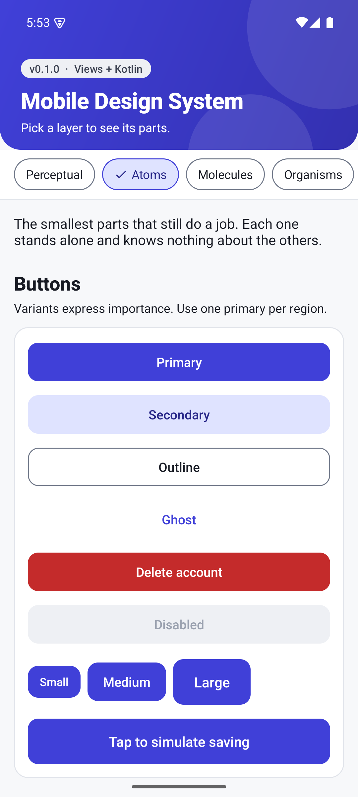
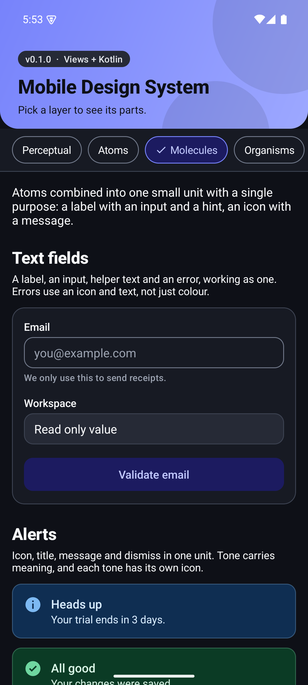
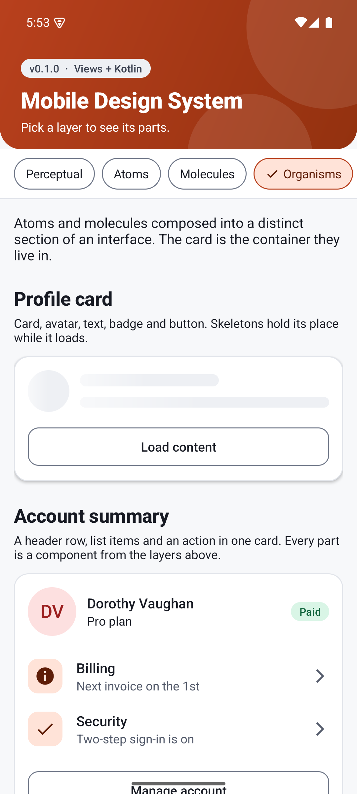
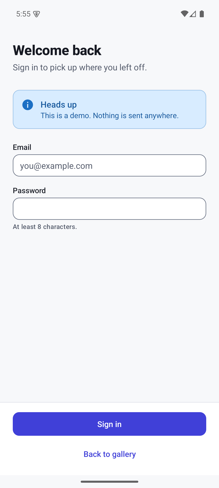

# Mobile Design System

A small, opinionated, **View-based** design system for Android, written in Kotlin, with no Jetpack Compose dependency.
It is meant to be read, copied and adapted: a reference for how a company can structure tokens, themes and
components so that a brand change, a dark mode and an accessibility fix are each a one-place change.

**Docs and guides: https://liconrepo.github.io/MobileDesignSystem/**

<p align="center">
  
  
  
  
</p>

## Why this exists

Most design-system write-ups show finished UI and hide the decisions. This repo keeps the decisions visible:

- **Three tiers of tokens**: primitive values, semantic roles, component defaults. Components only read roles.
- **One theme, many brands**: the `Sunset` brand is a 5-line theme overlay. Try it in the sample app.
- **Light and dark from the same tokens**: no per-component dark code.
- **Accessibility as a default**: 48dp touch targets, contrast-checked pairs, state never conveyed by colour alone,
  live-region announcements, reduced-motion support.
- **Small public API**: `explicitApi()` is on, so every public declaration is a deliberate decision.

## What is inside

| Module | What it is |
| --- | --- |
| [`designsystem`](designsystem) | The library: tokens (`res/values`), themes, and components (`MdsButton`, `MdsTextField`, ...). |
| [`sample`](sample) | A gallery app that uses the library exactly the way a consumer would, with one tab per layer. |
| [`docs`](docs) | Layers, principles, token reference, theming guide, component guidelines, contributor checklist. Also published as a [website](https://liconrepo.github.io/MobileDesignSystem/). |

### Components

| Layer | Component | Purpose |
| --- | --- | --- |
| Perceptual | `MdsTone`, `MdsMotion` | Shared tone vocabulary (six tones) and a single reduced-motion check |
| Atom | `MdsButton` | Five variants (primary, secondary, outline, ghost, destructive), three sizes, loading state |
| Atom | `MdsBadge` | Status label in six tones |
| Atom | `MdsChip` | Toggleable choice with a check mark when selected |
| Atom | `MdsAvatar` | Image or stable-colour initials, four sizes |
| Atom | `MdsSkeleton` | Loading placeholder with shimmer that respects "remove animations" |
| Atom | Switch (style) | `Mds.Widget.Switch` applied automatically by the theme |
| Molecule | `MdsTextField` | Always-visible label, helper text, error text with icon, saved state |
| Molecule | `MdsAlert` | Inline message, tone icon, optional dismiss, polite live region |
| Molecule | `MdsListItem` | Leading icon, title, subtitle, chevron |
| Organism | `MdsCard` | Flat, outlined or elevated container with a rounded ripple |
| Template | `MdsScreenTemplate` | Header, scrolling content and pinned footer, with no content of its own |

## Using it

Add the dependency (see [Publishing](#publishing)), then make your app theme extend `Theme.Mds`:

```xml
<style name="Theme.MyApp" parent="Theme.Mds" />
```

Use the components in layouts (see the [package map](#package-map) for where each one lives):

```xml
<io.github.liconrepo.mds.functional.atoms.MdsButton
    android:layout_width="match_parent"
    android:layout_height="wrap_content"
    android:text="Continue"
    app:mdsButtonVariant="primary" />

<io.github.liconrepo.mds.functional.molecules.MdsTextField
    android:layout_width="match_parent"
    android:layout_height="wrap_content"
    app:mdsLabel="Email"
    app:mdsHelperText="We only use this to send receipts."
    android:inputType="textEmailAddress" />
```

Or in code:

```kotlin
import io.github.liconrepo.mds.R
import io.github.liconrepo.mds.functional.atoms.MdsButton
import io.github.liconrepo.mds.perceptual.mdsColor

button.variant = MdsButton.Variant.Destructive
button.isLoading = true
field.errorText = "Enter a valid email."   // null clears it
val brand = context.mdsColor(R.attr.mdsColorPrimary)
```

Rebrand with an overlay (see `ThemeOverlay.Mds.Sunset`):

```kotlin
override fun onCreate(savedInstanceState: Bundle?) {
    theme.applyStyle(R.style.ThemeOverlay_Mds_Sunset, true)
    super.onCreate(savedInstanceState)
}
```

## Package map

The library is organised by the kind of pattern, following the functional/perceptual split in Kholmatova's
*Design Systems* and the atoms, molecules and organisms layering from Brad Frost's Atomic Design.

```
io.github.liconrepo.mds
  perceptual/               how it looks and feels: MdsTone, MdsMotion, theme helpers (mdsColor, mdsPx)
  functional/
    atoms/                  MdsButton, MdsBadge, MdsChip, MdsAvatar, MdsSkeleton
    molecules/              MdsTextField, MdsAlert, MdsListItem
    organisms/              MdsCard
  templates/                MdsScreenTemplate: header, scrolling content and pinned footer, with no content
```

Pages are the last stage. A page is a template filled with real content, so it belongs to the app, not the
library. The sample has two (`SignInPage`, `ProfilePage` in `sample/.../pages`), opened from the gallery.

The sample app has one tab per layer (Perceptual, Atoms, Molecules, Organisms, Templates, Pages), in the same order.

## Architecture in one picture

```
 primitive   mds_palette_ocean_600 = #4040D8        raw values, no meaning
     |
 semantic    mds_color_primary  -> ocean_600        values/  (light)
                                -> ocean_400        values-night/  (dark)
     |
 theme attr  ?attr/mdsColorPrimary                  what components read
     |
 component   MdsButton.refresh()                    never sees a raw colour
```

Read [docs/tokens.md](docs/tokens.md) and [docs/theming.md](docs/theming.md) for the full story.

## Build and run

```bash
./gradlew :sample:installDebug      # run the gallery on a device or emulator
./gradlew :designsystem:test        # unit tests
./gradlew :designsystem:lint        # lint
```

Requires JDK 17 and the Android SDK (compileSdk 36, minSdk 24).

## Publishing

Version `0.1.0` is configured for Maven publishing (`io.github.liconrepo:mds`).

```bash
./gradlew :designsystem:publishReleasePublicationToMavenLocal
```

then in a consumer project:

```kotlin
repositories { mavenLocal() }
dependencies { implementation("io.github.liconrepo:mds:0.1.0") }
```

To distribute publicly, push a version tag and use [JitPack](https://jitpack.io)
(`jitpack.yml` is included), or add a Maven Central repository to the publishing block.

## Credits and inspiration

The structure borrows *ideas* (never code or assets) from public design systems and writing:

- [Material Design](https://m3.material.io)
- [IBM Carbon](https://carbondesignsystem.com)
- [Shopify Polaris](https://polaris.shopify.com)
- [GitHub Primer](https://primer.style)
- [Atlassian Design System](https://atlassian.design)
- [Microsoft Fluent](https://fluent2.microsoft.design)
- Airbnb's public design-language writing, such as Karri Saarinen's [Design Language System](https://karrisaarinen.com/dls/)
- Brad Frost's [Atomic Design](https://bradfrost.com/blog/post/atomic-web-design/), the source of the atoms,
  molecules and organisms layering (see also the [book](https://atomicdesign.bradfrost.com))
- Alla Kholmatova's book [*Design Systems*](https://www.smashingmagazine.com/design-systems-book/)
  (Smashing Magazine, 2017), notably its split between functional and perceptual patterns, its emphasis on
  shared vocabulary and its principles-first approach

Colours, icons and code here are original.

## License

MIT. See [LICENSE](LICENSE).
